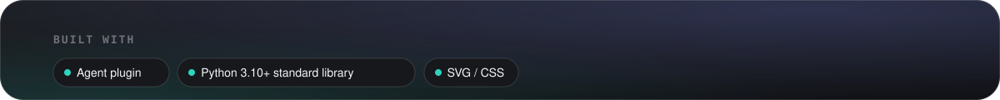

<a href="https://canessasyslabs.com/exedrion/"><b>See it on canessasyslabs.com&nbsp;&nbsp;→</b></a>&nbsp;&nbsp;·&nbsp;&nbsp;<a href="https://chatgpt.com/plugins/plugins_6ac95bda4e0081919d68779d339203df"><b>Try it in ChatGPT&nbsp;↗</b></a>

An ambitious assignment deserves more than a pile of notes. Exedrion keeps the purpose of the work in view from first question to final review. Ten skills connect research, writing, production and review, and a local evidence ledger shows what is complete, what changed and what still needs your decision.

https://github.com/user-attachments/assets/49f2bb7f-7ef2-4be2-95ee-20486dea6343

https://github.com/user-attachments/assets/07b6fe22-5dd3-4f3d-a139-59892cecf3ba

© Canessa System Labs. All rights reserved. This repository presents the work; it does not license it. No part of its text, images or design may be reused without written permission.

